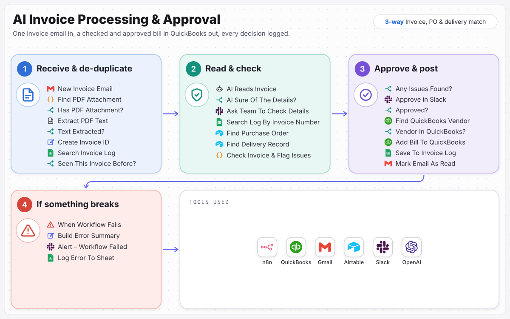

# AI Invoice Processing & Approval

Every invoice checked against the PO and delivery record before anyone approves it.

> Built for **Braewick Construction Group**, a fictional sample client. The business, people and data are invented; the workflow is complete and runs.

Reads invoices from Gmail, skips duplicates, has AI pull out the details, checks them against purchase orders and delivery records, gets approval in Slack and adds the bill to QuickBooks. Built for construction, including progress payments, retention and lien waivers.

**Full case study:** [ramonvallejera.com/case-study/ai-invoice-processing-approval](https://ramonvallejera.com/case-study/ai-invoice-processing-approval)

## How it works

1. Invoice email
2. PDF text
3. Duplicate check
4. AI reads the invoice
5. Checked against PO and delivery record
6. Approval in Slack
7. Bill added to QuickBooks
8. Logged

Built an n8n workflow that picks up invoice emails every 5 minutes, skips duplicates, has AI extract every billing figure, and checks them with fixed rules against the purchase order and delivery record in Airtable. Clean invoices go to the budget owner and invoices with issues to accounts payable, both in Slack. Approved bills are added to QuickBooks at the amount to pay after retention, and every outcome is logged.

## What's in this repo

| File | What it is |
|---|---|
| `workflow.json` | The n8n workflow, 55 nodes, ready to import |
| `docs/process-map.svg` | The process map from the case study |

Triggers: `New Invoice Email`, `When Workflow Fails`, `Process One Invoice Email`.

## Set it up

1. In n8n, open **Workflows → Import from File** and choose `workflow.json`.
2. Create these credentials and select them on the nodes that need them:

   - Slack (OAuth2) (10 nodes)
   - Google Sheets (OAuth2) (4 nodes)
   - Gmail (OAuth2) (3 nodes)
   - Airtable (personal access token) (2 nodes)
   - QuickBooks Online (OAuth2) (2 nodes)
   - OpenAI (1 node)

3. Replace the placeholders with your own records:

   - `THIS_WORKFLOW_ID` (1×): the workflow calls itself, so use its own ID from the URL after import
   - `YOUR_AIRTABLE_BASE_ID` (2×)
   - `YOUR_AIRTABLE_TABLE_ID` (2×): each node keeps the original table name as a hint
   - `YOUR_GOOGLE_SHEET_ID` (4×)
   - `YOUR_SLACK_CHANNEL_ID` (10×): the channel that receives alerts and approvals

4. Run it once with test data, then activate it.

Tools: n8n, QuickBooks, Gmail, Airtable, Slack, OpenAI.

## Notes

- Credentials, webhook IDs, pinned test data and account-specific IDs were removed before publishing. n8n assigns new webhook URLs on import.
- Built by [Ramon Vallejera Jr.](https://ramonvallejera.com), AI Automation Engineer. Questions or a build like this for your team: [ramonvallejera.com/contact](https://ramonvallejera.com/contact).
